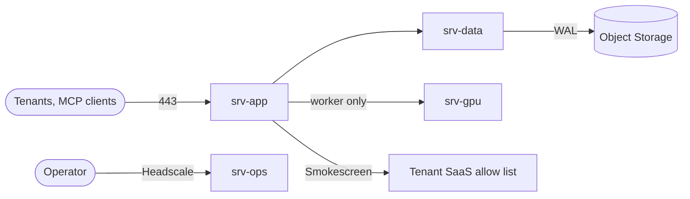

# 00 · Overview

## In one glance
- Multi tenant AI agent platform: one codebase, 3 cloud + 1 GPU.
- Postgres FORCED RLS is the guarantee; every other control is backup.
- Self hosted Qwen3: prompts never leave Hetzner; model still assumed hostile.

## The rule: fail closed
- Return the right tenant's data, or return no data.
- Never return another tenant's data, whatever the model does.
- Every guardrail in [05](05-threat-model.md) and [06](06-security-guardrails.md) traces back here.

## Principles
1. Tenant identity is born at the edge, immutable downstream.
2. Postgres RLS is the guarantee; EF filters and prefixes are backup.
3. Per tenant encryption keys: a logical leak yields ciphertext.
4. Agents are tenant config run by one shared stateless loop.
5. Model output is untrusted input; tools and egress are allow listed.
6. Workflows are deterministic Hangfire jobs; agent runs are steps.
7. Two trust boundaries: world vs platform, operators vs platform.
8. Pooled by default; silo is a tier column plus a runbook.
9. Guardrails are tested: leak suite in CI and as production canary.

## Repo map
| Path | Holds |
|---|---|
| `docs/`, `docs/adr/` | 00 to 14, ten decision records |
| `infra/` | terraform, ansible roles, compose per server |
| `db/migrations/` | fail closed tenancy SQL |
| `src/`, `tests/` | `Cortex.sln` skeleton; unit, integration, security, perf |
| `.github/workflows/` | unit, integration, security gates; signed image |

## Servers (Hetzner API, 2026-11-09, EUR net/month)
| Server | Type | Cost | Runs |
|---|---|---|---|
| srv-app | CCX23, 4 vCPU, 16 GB | 85.99 | Traefik, web, worker, Keycloak, Smokescreen |
| srv-data | CCX33, 8 vCPU, 32 GB | 138.49 | Postgres+pgvector, PgBouncer, Valkey, OpenBao, pgBackRest |
| srv-ops | CPX32, 4 vCPU, 8 GB | 35.49 | Grafana stack, Headscale |
| srv-gpu | GEX44, RTX 4000 Ada 20 GB | 232.30 | vLLM, Qwen3-14B-AWQ, no egress |

## Decisions
| Decision | Alternative | Why it lost |
|---|---|---|
| CPX32 for srv-ops | CX33 | Unavailable in all EU locations today |
| vLLM with per tenant `cache_salt` | Ollama | No batching; shared prefix cache |
| Headscale public on srv-ops | Behind srv-app Traefik | Ops door survives app compromise |

## Open questions
- GEX44 throughput for 100 tenants needs a benchmark.
- Cloud network to Robot vSwitch coupling: confirm at order.
