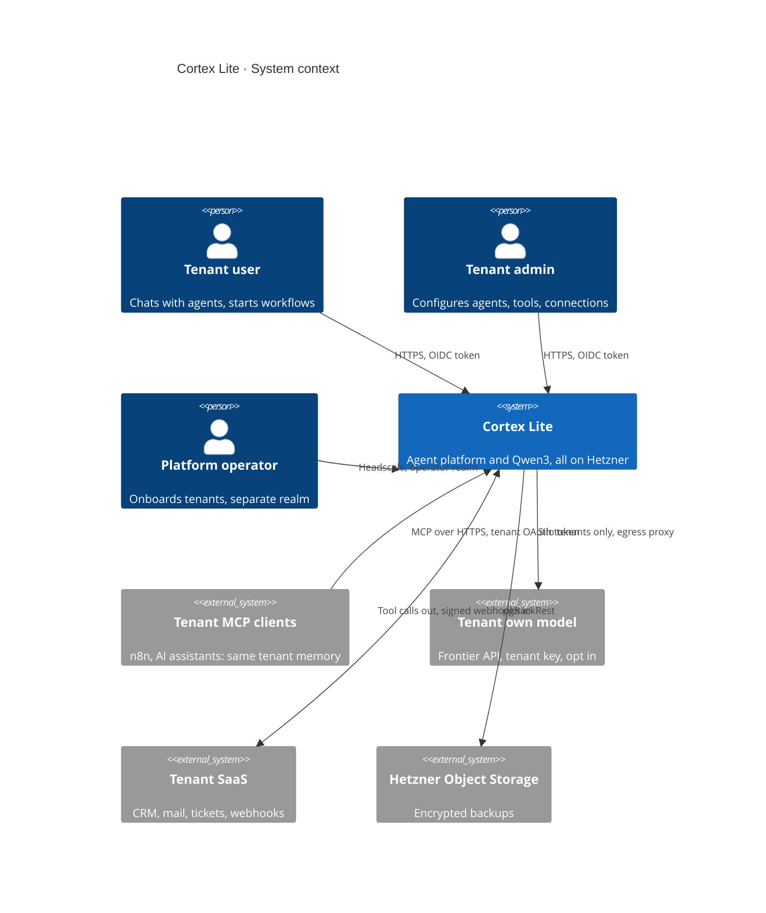

# 03 · C1 System context

## In one glance
- Operator onboards tenants; no self service signup.
- n8n and AI assistants share tenant memory through one tenant bound MCP endpoint.
- A tenant that misbehaves is quarantined alone; others never notice.

## Diagram

## Actors
| Actor | Identity | Can reach |
|---|---|---|
| Tenant user | Tenant realm, `tenant_id` claim | Own tenant's agents and chats |
| Tenant admin | Same realm, admin role | Own config, connections, MCP clients |
| Platform operator | Operator realm, Headscale node | Onboarding, quarantine; data via audited break glass |

## External systems
| System | Trust | Isolation rule |
|---|---|---|
| n8n, AI assistants via MCP | Untrusted caller and content | Tenant from token; memory writes tagged `source=mcp:<client>` |
| Tenant own model | Untrusted output | Silo tier only; key in tenant Vault KV |
| Tenant SaaS | Untrusted responses | OAuth tokens in Vault; webhooks bound by path secret |

## Trust boundaries
| Boundary | Between | Enforced by |
|---|---|---|
| B1 | World (incl. model output, MCP) and platform | Traefik TLS, JWT check, egress proxy |
| B2 | Operators and platform | Headscale, operator realm, audit log |
| Logical | Tenant and tenant | FORCED RLS, tenant keys, quarantine |

## Decisions
| Decision | Alternative | Why it lost |
|---|---|---|
| Shared memory via MCP endpoint | n8n reads Postgres directly | Bypasses tenant pinning and provenance |
| Auto quarantine (reversible), manual crypto shred | Auto self destruct | One false alarm deletes a customer |
| Bring your own model forces silo tier | Pooled with per tenant egress | Customer asked for complete isolation |

## Open questions
- n8n: tenants host their own (Sustainable Use); founder confirms with n8n.
- Hosted AI assistants: off by default; tenant admin opts in per agent.
- Quarantine thresholds: see [12](12-observability-audit.md).
