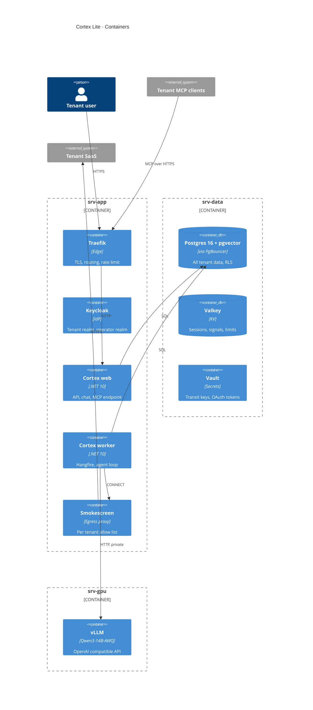

# 04 · C2 Containers

## In one glance
- One image, two roles: `web` and `worker`, chosen by start argument.
- Only the worker reaches the model and the outside world.
- Every store isolates by tenant independently of app code.

| Container | Server | Stores | Talks to | Isolation mechanism |
|---|---|---|---|---|
| Traefik | srv-app | Nothing | web, Keycloak | Only public 443; rate limit per `tenant_id` |
| Keycloak | srv-app | Realms in Postgres (own DB) | Postgres | `tenant_id` claim from group, not user input |
| web | srv-app | Nothing | Postgres, Valkey, Vault | TenantContext from JWT; no egress |
| worker | srv-app | Nothing | Postgres, Valkey, Vault, vLLM, Smokescreen | Context from signed job envelope |
| Smokescreen | srv-app | Nothing | Allow listed hosts | Role per tenant from mTLS cert |
| Postgres + PgBouncer | srv-data | All tenant rows, vectors, Hangfire | none | FORCED RLS, tx local tenant |
| Valkey | srv-data | Sessions, signals, quotas | none | Key prefix + ACL per role; values sealed |
| Vault | srv-data | Tenant keys, OAuth tokens | none | Path per tenant; AppRole per role |
| vLLM | srv-gpu | KV cache only | none | `cache_salt` per tenant; no egress |
| Grafana stack | srv-ops | Logs, traces, metrics | all (scrape) | `tenant_id` label; no payloads logged |

## Decisions
| Decision | Alternative | Why it lost |
|---|---|---|
| MCP endpoint inside web role | Separate MCP service | Second deployable for one route |
| Smokescreen identifies tenant via client cert | Single shared egress list | One tenant's domains open to all |

## Open questions
- Keycloak on srv-app or srv-data under load?
