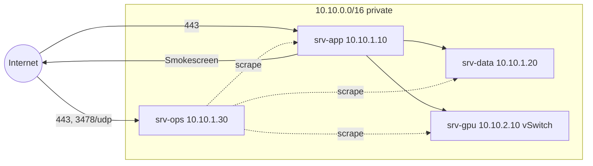

# 09 · Network

## In one glance
- Two public doors: app 443, ops Headscale. Nothing else.
- No public SSH; operators arrive over the Headscale tailnet.
- Only the worker egresses, and only through Smokescreen.

## Firewall (Hetzner Cloud firewall + nftables)
| From | To | Port | Why |
|---|---|---|---|
| Internet | srv-app | 443/tcp | Tenant traffic, MCP |
| Internet | srv-ops | 443/tcp, 3478/udp | Headscale + DERP |
| srv-app | srv-data | 6432, 6379, 8200 | PgBouncer, Valkey, Vault |
| srv-app (worker) | srv-gpu | 8000 | vLLM |
| srv-ops | all | 9100, exporters | Prometheus scrape |
| srv-data | srv-ops | 3100, 4317 | Loki, OTLP |
| tailnet | all | 22 | Operator SSH |

## Egress allow list
- srv-app worker: Smokescreen only; tenant SaaS domains per tenant.
- srv-app host: Docker registry, OS mirrors, Let's Encrypt.
- srv-data: Hetzner Object Storage only (WAL archive).
- srv-gpu: none after provisioning.

## Decisions
| Decision | Alternative | Why it lost |
|---|---|---|
| nftables `DOCKER-USER` chain | ufw | Docker bypasses ufw rules |
| Headscale public on srv-ops | Behind srv-app | Ops door survives app compromise |

## Open questions
- Cloud network to Robot vSwitch coupling: confirm MTU (unverified).
