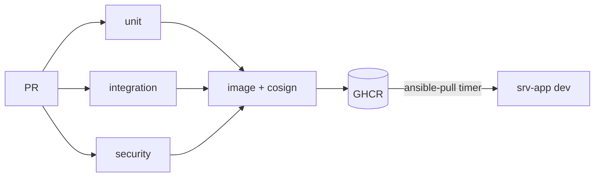

# 10 · Deployment

## In one glance
- CI builds and proves; servers pull. CI holds no prod credentials.
- Security suite failure blocks the image; same suite runs as canary.
- Rule: [00-overview](00-overview.md#the-rule-fail-closed).

| Stage | Tool | Gate |
|---|---|---|
| Build | `dotnet build` net10.0 | Warnings as errors |
| Unit | `tests/Cortex.UnitTests` | All green, no I/O |
| Integration | `tests/Cortex.IntegrationTests` + Testcontainers | Real Postgres, Valkey, OpenBao |
| Security | `db/checks` + `tests/Cortex.SecurityTests` | Zero cross tenant rows; FORCED RLS everywhere |
| Perf | k6 `tests/perf` after deploy | p95 < 300 ms, errors < 1% |
| Image | Docker buildx | One image, `web` and `worker` roles |
| Sign | cosign keyless | Host verifies before pull |
| Deploy dev | ansible-pull on srv-app | Health check + canary green |

## Rollback
1. Set `cortex_image_tag` to previous signed tag.
2. Run `ansible-pull`; compose restarts both roles.
3. Confirm canary green in Grafana.

## Migration rules
- Expand, then contract; never both in one release.
- Every new tenant table ships with FORCE RLS in same migration.
- Any policy or role change is a security review.
- Migrations run as `cortex_owner`; app runs as `cortex_app`.

## Secrets rule
- Apps authenticate to Vault by AppRole only.
- No secret in git, image, or compose file.

## Decisions
| Decision | Alternative | Why it lost |
|---|---|---|
| GitHub Actions | Woodpecker | Needs its own server; demo is public |
| Pull deploy | SSH push from CI | CI would hold prod access |

## Open questions
- Staging environment or dev only for the demo?
